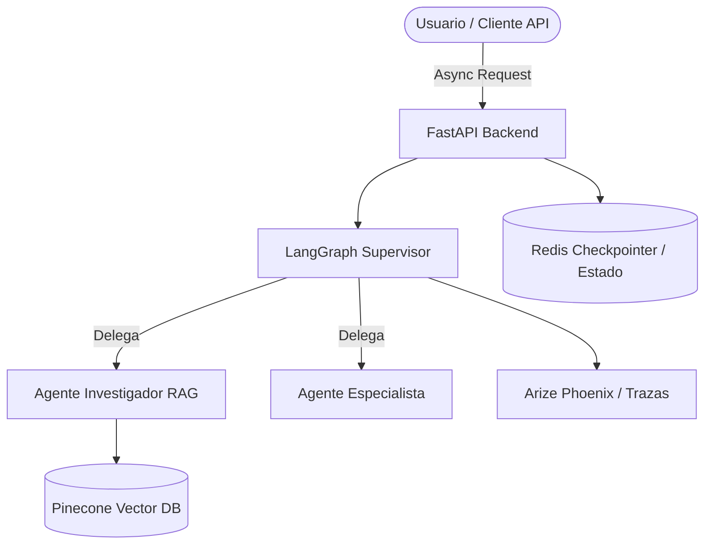

# The Intelligence System (Entrega 7)

Sistema de inteligencia artificial de grado de producción, diseñado para razonar, recordar, escalar y ofrecer trazabilidad completa. Este proyecto consolida e integra pre-entregas previas (RAG, Agentes con supervisor en LangGraph, API con FastAPI y persistencia con Redis y Pinecone) en una única arquitectura limpia, asíncrona y robusta.

---

## 🏗️ Arquitectura del Sistema

El sistema implementa un flujo unificado estructurado en capas:

1. **Capa de API (FastAPI):** Interfaz profesional y documentada para peticiones asíncronas concurrentes.
2. **Capa de Orquestación y Razonamiento (LangGraph):** Grafo de agentes con un *Supervisor* autónomo capaz de delegar subtareas, evaluar resultados y corregir errores.
3. **Capa de Memoria y Persistencia:** Uso de *Checkpointers* de LangGraph respaldados por Redis para asegurar que las conversaciones no se pierdan al reiniciar.
4. **Capa de Conocimiento (RAG Avanzado):** Recuperación híbrida y gestión de metadatos utilizando **Pinecone** como base de datos vectorial.
5. **Capa de Observabilidad:** Trazado de ejecución de punta a punta con *Arize Phoenix* o *LangSmith*.



---

## 🛠️ Requisitos del Sistema

- **Python 3.12+**
- **[uv](https://github.com/astral-sh/uv)** (Gestor de dependencias ultrarrápido)
- **Docker & Docker Compose** (Opcional, para ejecución local de servicios complementarios como Redis)

---

## 🚀 Instalación y Configuración (con `uv`)

### 1. Instalar `uv` (si no lo tienes en tu sistema)

- **macOS / Linux:**		curl -LsSf https://astral.sh/uv/install.sh | sh
- **Windows (PowerShell):**		irm https://astral.sh/uv/install.ps1 | iex

### 2. Clonar el repositorio y sincronizar el entorno

```bash
git clone https://github.com/diegofziegler/entrega_7.git  
cd entrega_7  
uv sync
```

### 3. Configurar las Variables de Entorno

Crea un archivo `.env` basado en el archivo de ejemplo y completa tus credenciales (asegúrate de no hardcodear claves ni índices):

```bash
cp .env.example .env
```

*(Variables requeridas: `OPENAI_API_KEY`, `PINECONE_API_KEY`, `PINECONE_INDEX_NAME`, `REDIS_URL`, etc.)*

---

## ▶️ Ejecución del Proyecto

### Opción A: Ejecución local con `uv`

Para iniciar el servidor de desarrollo de FastAPI utilizando el entorno virtual gestionado automáticamente por `uv`:

```bash
uv run uvicorn src.main:app --reload
```

### Opción B: Despliegue Local con Docker Compose

Para levantar todo el stack de servicios de forma unificada:

```bash
docker compose up --build
```

---

## 📊 Observabilidad y Trazas

El sistema cuenta con observabilidad integrada para auditar cada ejecución de punta a punta:

1. Configura tu proveedor de trazas (*Arize Phoenix* o *LangSmith*) en el archivo `.env`.
2. Ejecuta pruebas del sistema. Las capturas del dashboard con los árboles de *spans* y costos asociados se almacenan en el directorio [`./trazas`](./trazas).


---

## 🧪 Pruebas

Para ejecutar la suite de pruebas unitarias y de integración utilizando `uv`:

```bash
uv run pytest
```

 
