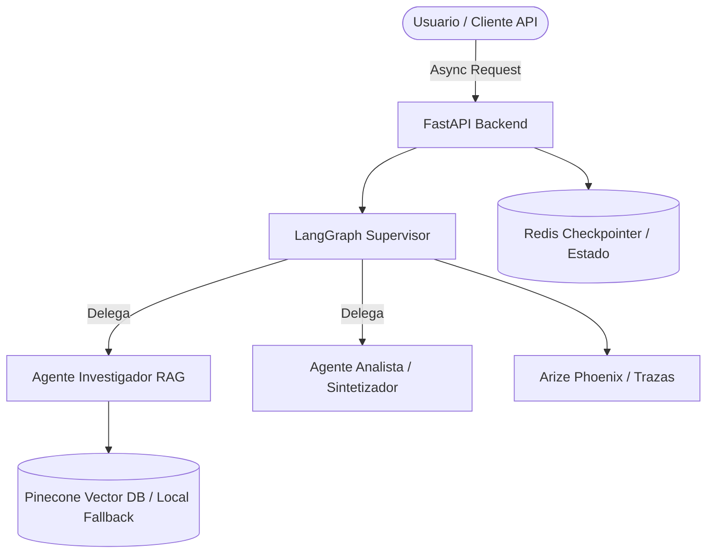

# The Intelligence System (Entrega 7)

Sistema de inteligencia artificial de grado de producción, diseñado para razonar, recordar, escalar y ofrecer trazabilidad completa. Este proyecto consolida e integra pre-entregas previas (RAG, Agentes con supervisor en LangGraph, API con FastAPI y persistencia con Redis y Pinecone) en una única arquitectura limpia, asíncrona y robusta.

---

## 🏗️ Arquitectura del Sistema

El sistema implementa un flujo unificado estructurado en capas:

1. **Capa de API (FastAPI):** Interfaz profesional y documentada con endpoints asíncronos para chat multi-agente (`/api/v1/chat`), consulta de historial (`/api/v1/history/{thread_id}`), ingesta de conocimiento (`/api/v1/rag/ingest`) y verificación de estado (`/health`).
2. **Capa de Orquestación y Razonamiento (LangGraph):** Grafo de agentes con un *Supervisor* autónomo capaz de delegar tareas entre el *Agente Investigador RAG* y el *Agente Analista/Sintetizador* multilingüe.
3. **Capa de Memoria y Persistencia:** Uso de *Checkpointers* de LangGraph respaldados por Redis (o almacenamiento en memoria resiliente) para garantizar que el estado de las conversaciones persista por `thread_id`.
4. **Capa de Conocimiento (RAG Avanzado):** Recuperación híbrida y gestión de metadatos utilizando **Pinecone** como base de datos vectorial (con fallback local/en memoria resiliente para desarrollo y pruebas).
5. **Capa de Observabilidad:** Trazado de ejecución de punta a punta con **Arize Phoenix** (OpenInference / OTLP) y generación de logs dedicados (`log/agentes.log` y `log/rag.log`).



---

## 🛠️ Requisitos del Sistema

- **Python 3.12+**
- **[uv](https://github.com/astral-sh/uv)** (Gestor de dependencias ultrarrápido)
- **Docker & Docker Compose** (Opcional, para ejecución de servicios complementarios como Redis)

---

## 🚀 Instalación y Configuración (con `uv`)

### 1. Instalar `uv` (si no lo tienes en tu sistema)

- **macOS / Linux:** `curl -LsSf https://astral.sh/uv/install.sh | sh`
- **Windows (PowerShell):** `irm https://astral.sh/uv/install.ps1 | iex`

### 2. Clonar el repositorio y sincronizar el entorno

```bash
git clone https://github.com/diegofziegler/entrega_7.git  
cd entrega_7  
uv sync
```

### 3. Configurar las Variables de Entorno

Crea un archivo `.env` basado en el archivo de ejemplo:

```bash
cp .env.example .env
```

*(Variables requeridas / opcionales: `GEMINI_API_KEY`, `GROQ_API_KEY`, `OPENAI_API_KEY`, `PINECONE_API_KEY`, `PINECONE_INDEX_NAME`, `REDIS_URL`, `PHOENIX_COLLECTOR_ENDPOINT`, etc.)*

---

## ▶️ Ejecución del Proyecto

### Opción A: Ejecución local con `uv`

Para iniciar el servidor de desarrollo de FastAPI utilizando el entorno virtual gestionado por `uv`:

```bash
uv run uvicorn src.entrega_7.main:app --reload
```

---

## 📊 Observabilidad e Inicialización de Trazas (Arize Phoenix)

El sistema cuenta con trazabilidad completa de cada ejecución utilizando **Arize Phoenix** y OpenInference.

### 1. Iniciar el Servidor de Observabilidad (Arize Phoenix)

Para levantar el panel visualizador de trazas localmente, ejecuta:

```bash
uv run phoenix serve
```

Por defecto, la interfaz de Phoenix estará disponible en: **`http://localhost:6006`**

### 2. Configuración en `.env`

Asegúrate de tener configuradas las siguientes variables en tu archivo `.env`:

```env
PHOENIX_COLLECTOR_ENDPOINT=http://localhost:6006
PHOENIX_PROJECT_NAME=orquestador-multi-agente
```

### 3. Visualización y Evidencias

- Toda llamada enviada a la API (`POST /api/v1/chat`) instrumenta automáticamente los *spans* de LangGraph, consultas RAG e invocaciones a los modelos LLM.
- Al ingresar a `http://localhost:6006`, podrás inspeccionar en tiempo real el árbol de llamadas, latencias, token count y costos asociados a cada interacción.
- Las evidencias e instrucciones adicionales se almacenan en el directorio [`./trazas`](./trazas).

### 4. Archivos de Log Locales

Además de la telemetría OTLP, el sistema registra actividades separadas en:
- **`./log/agentes.log`**: Transiciones del supervisor, decisiones y respuesta del analista.
- **`./log/rag.log`**: Carga de embeddings, ingesta de `.md` y búsquedas de similitud.

---

## 🌐 Endpoints de la API

- `GET /health`: Verificación del estado del sistema, proveedor LLM activo y estado del RAG y Checkpointer.
- `POST /api/v1/chat`: Inicia o continúa una interacción con el orquestador multi-agente.
  - **Payload:**
    ```json
    {
      "message": "¿De qué tratan las técnicas básicas del Karate Uechi-Ryu?",
      "thread_id": "sesion-123",
      "idioma_destino": "Inglés"
    }
    ```
- `GET /api/v1/history/{thread_id}`: Recupera el historial de mensajes asociado a una sesión activa.
- `POST /api/v1/rag/ingest`: Ejecuta o fuerza la ingesta de documentos Markdown ubicados en `./data`.

---

## 🧪 Pruebas Unitarias e Integración

Para ejecutar la suite completa de pruebas unitarias e integración:

```bash
PYTHONPATH=. uv run pytest tests/test_system.py
```
