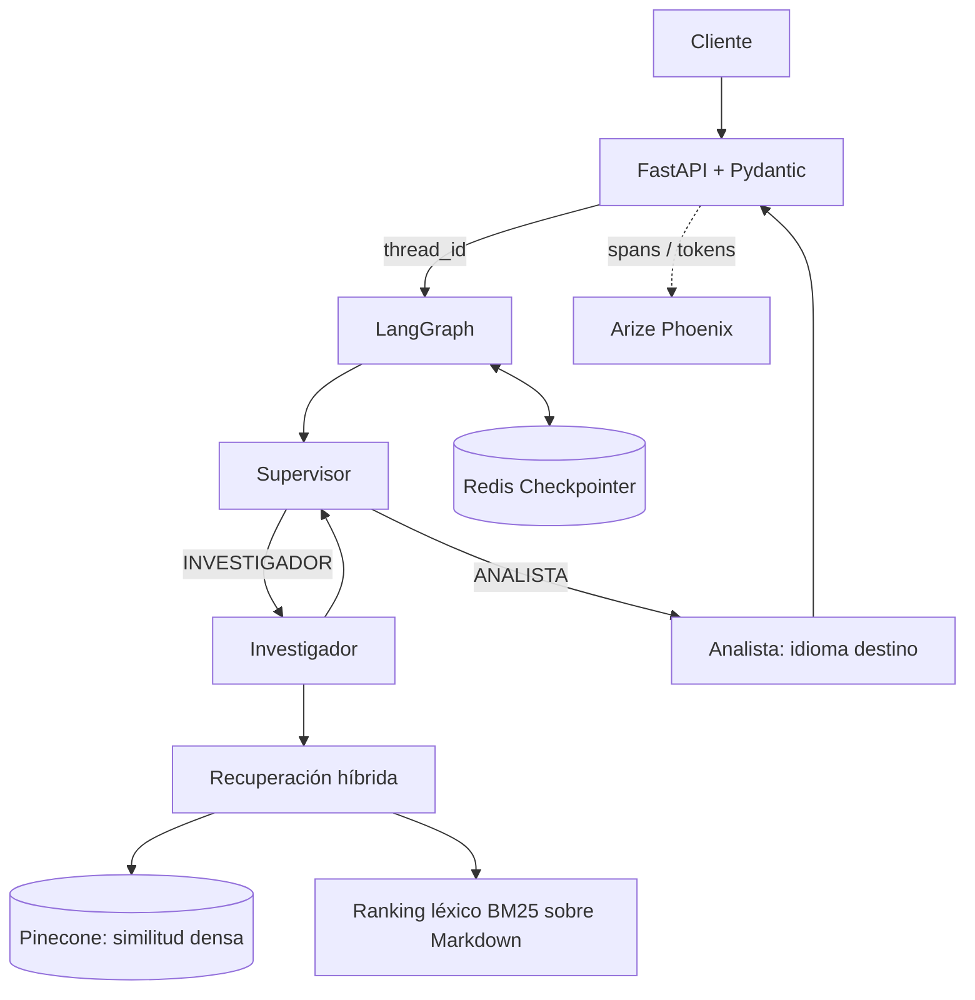

# Entrega 7 — sistema multiagente con RAG

API asíncrona con FastAPI y LangGraph. Redis conserva los checkpoints por `thread_id`, Pinecone almacena los fragmentos y participa en la recuperación híbrida densa + léxica, y OpenInference exporta spans a Arize Phoenix.

## Arquitectura



El índice semántico vive en Pinecone. La señal léxica se calcula sobre los fragmentos Markdown cargados durante la ingesta; ambas listas se combinan con Reciprocal Rank Fusion. Cada chunk usa un ID determinista para que las ingestas repetidas actualicen el mismo vector.

Las decisiones del supervisor y la síntesis del analista se componen como cadenas LCEL (`prompt | modelo | parser/validación`). El buscador híbrido async se expone como `Runnable` con contratos Pydantic para que LangGraph conserve el control del flujo y sus checkpoints.

## Cómo levantar el entorno y ejecutar las pruebas

Sigue estos pasos en **PowerShell**. Docker Compose levanta FastAPI, Redis Stack y Phoenix. La API también necesita credenciales válidas del proveedor LLM y de Pinecone, que son servicios externos.

### 1. Instalar las herramientas

Instala Docker Desktop con Docker Compose y [`uv`](https://docs.astral.sh/uv/). Para correr los comandos del host, `uv` instalará/seleccionará Python 3.12+ y las dependencias declaradas en `pyproject.toml`.

Si todavía no clonaste el repositorio:

```powershell
git clone https://github.com/diegofziegler/entrega_7.git
Set-Location entrega_7
```

Si ya lo tienes, cambia a su carpeta. Confirma la ubicación antes de seguir:

```powershell
Get-Location
```

### 2. Crear y completar `.env`

Si todavía no tienes `.env`, créalo desde el ejemplo:

```powershell
Copy-Item .env.example .env
```

Abre `.env` y completa las claves reales:

- Elige `LLM_PROVIDER=gemini`, `groq` u `openai` y completa la clave correspondiente.
- Completa `OPENAI_API_KEY`: RAG usa `text-embedding-3-small` para crear embeddings, aunque el LLM de chat sea Gemini o Groq.
- Completa `PINECONE_API_KEY` y confirma que `PINECONE_INDEX_NAME` identifica un índice existente.

El índice Pinecone debe tener dimensión `1536` y métrica `cosine`. `PINECONE_NAMESPACE` selecciona el namespace. No subas `.env` ni claves reales al repositorio. Redis y Phoenix usan los valores de Compose; dentro de la red Docker, Compose configura los nombres de host internos para la API.

### Ejecución integral en un comando (recomendada)

Una vez que `.env` tiene las claves completadas manualmente, ejecuta desde la raíz:

```powershell
.\run_acceptance.ps1
```

El script valida que las claves requeridas estén presentes sin imprimir sus valores, sincroniza dependencias con `uv` y construye y levanta Docker Compose. Después consulta `http://localhost:8000/health` cada 5 segundos hasta que la respuesta indique `status=ok`, `rag_status=active` y `checkpointer=redis`; así da tiempo a que la API inicie y termine la preparación de RAG. El tiempo máximo de espera es de 10 minutos por defecto.

Si el arranque tarda más, puedes aumentar ese límite, por ejemplo a 15 minutos:

```powershell
.\run_acceptance.ps1 -HealthTimeoutMinutes 15
```

Si vence el plazo, el script muestra los últimos 100 registros del contenedor API, informa el último estado observado y termina con error. **Deja los contenedores activos** para facilitar el diagnóstico. Cuando el health check está listo, ejecuta `pytest` con persistencia real en Redis y luego la prueba de cinco preguntas. Al finalizar correctamente también deja Docker activo para inspeccionar Phoenix. Los resultados quedan en `trazas/spans.json` y `tests/test_5_preguntas.log`.

Las API keys siempre se ingresan manualmente en `.env`; el script no las genera, no las muestra ni las agrega al repositorio. Si alguna está vacía o falta, termina antes de levantar los servicios y señala el nombre de la variable que debes completar.

En caso de error, muestra el paso fallido y conserva los contenedores para diagnóstico. Para detenerlos luego sin borrar checkpoints de Redis, usa `docker compose down` (sin `-v`). El resto de esta sección documenta el flujo manual equivalente.

### 3. Flujo manual: levantar los contenedores

```powershell
docker compose up --build -d
```

La primera ejecución puede tardar porque construye la imagen e instala dependencias. Revisa el arranque de la API:

```powershell
docker compose logs -f api
```

Espera a que la API termine la inicialización y la ingesta de `data/`. Cuando termine de revisar los logs, puedes salir de `logs -f` con `Ctrl+C`; esto no detiene los contenedores.

### 4. Confirmar que el ambiente está listo

En otra terminal de PowerShell, consulta el health check:

```powershell
Invoke-RestMethod -Uri "http://localhost:8000/health" -Method Get
```

Para ejecutar la prueba completa, espera a ver `status: ok`, `rag_status: active` y `checkpointer: redis`. Si el endpoint no responde, espera unos segundos y vuelve a consultarlo. Si muestra `degraded` o RAG `unavailable`, revisa las claves y la inicialización en `.env` y los logs antes de disparar la prueba.

Direcciones locales:

- API: `http://localhost:8000`
- Documentación interactiva: `http://localhost:8000/docs`
- Dashboard Phoenix: `http://localhost:6006`

### 5. Disparar las cinco preguntas y consultar los historiales

Con el health check correcto, ejecuta desde la raíz del repositorio:

```powershell
uv run python tests/test_5_preguntas.py
```

El script primero consulta `/health`; después envía las cinco preguntas, una por una, a `POST /api/v1/chat` y consulta `GET /api/v1/history/{thread_id}` para cada conversación. Solicita las respuestas en este orden: español, inglés, francés, portugués y español. Usa un `thread_id` distinto por pregunta y por ejecución. Imprime las respuestas y el historial en consola, y escribe los detalles y errores en `tests/test_5_preguntas.log`.

Al final, consulta el proyecto `entrega-7` en Phoenix (`http://localhost:6006`) y exporta sus spans a `trazas/spans.json`. La exportación sigue el alcance del cliente Phoenix por proyecto, así que el JSON puede contener spans previos del mismo proyecto además de los de esta ejecución. Para entregar evidencia visual, captura el árbol de spans y el costo configurado en Phoenix según las instrucciones de [`trazas/README.md`](./trazas/README.md).

Si la prueba termina con error, revisa primero el mensaje de consola y luego `tests/test_5_preguntas.log`; el script devuelve código de salida `1` cuando falla una solicitud, la consulta del historial o la exportación de Phoenix.

### 6. (Opcional) Ejecutar las pruebas automatizadas

Las pruebas unitarias usan dobles para LLM y Pinecone, así que no necesitan esas credenciales:

```powershell
uv sync --frozen
uv run pytest -q
```

Para incluir la prueba de persistencia real en Redis, mantén los contenedores arriba y ejecuta:

```powershell
$env:TEST_REDIS_URL = "redis://localhost:6379"
uv run pytest -q
Remove-Item Env:TEST_REDIS_URL
```

La prueba de Redis se omite si `TEST_REDIS_URL` no está definido. Redis conserva sus datos en el volumen Docker `redis_data`. Para detener el ambiente sin borrar los checkpoints:

```powershell
docker compose down
```

No agregues `-v` si quieres conservar la memoria persistida en Redis.

### Ejecución local de la API (opcional)

Si prefieres ejecutar FastAPI en el host en lugar de en Docker, mantén Redis Stack y Phoenix activos en Docker y ejecuta:

```powershell
uv sync --frozen
uv run entrega-7
```

La API local utiliza `REDIS_URL=redis://localhost:6379` y `PHOENIX_COLLECTOR_ENDPOINT=http://localhost:6006` del `.env`.

## API

- `GET /health`: informa estado de Pinecone/RAG y el checkpointer Redis.
- `POST /api/v1/chat`: `{"message":"¿Quién fue Kanbun Uechi?","thread_id":"sesion-1","idioma_destino":"English"}`.
- `GET /api/v1/history/{thread_id}`: carga el estado guardado en Redis.
- `POST /api/v1/rag/ingest`: reingesta `DATA_DIR` de forma idempotente.

Los modelos Pydantic rechazan campos inesperados, contenido vacío y valores fuera de límites. El supervisor usa salida estructurada; el investigador valida parámetros y resultados de búsqueda.

## Observabilidad

Phoenix recibe los spans OTLP de LangChain/OpenInference y un span raíz `api.chat` que incluye `thread_id` e idioma destino. La instrumentación registra llamadas y uso de tokens cuando el proveedor lo expone. En Phoenix configura el pricing del modelo para visualizar costo estimado por ejecución. Registros separados: `log/agentes.log` y `log/rag.log`.

El procedimiento para capturar evidencia desde el dashboard está en [`trazas/README.md`](./trazas/README.md). Las capturas requieren ejecutar la aplicación con credenciales válidas y Phoenix activo.
